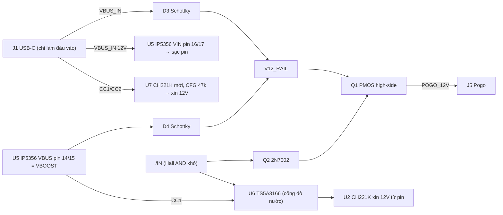

# Đề xuất sửa Power_Bank_Rev1 để có đủ 3 chức năng

## 1. Mạch hiện tại đang làm gì (phân tích từ netlist)

| Net | Đang nối vào |
|---|---|
| `/VDD` | **J1.VBUS (USB‑C) + U5.VBUS (IP5356, pin 14/15) + J5 (pogo 12V)** + R12→U2 (CH221K) |
| `/CC1` | J1.CC1 + U5.CC1 + U6 (TS5A3166) → U2.CC1 |
| `/CC2` | J1.CC2 + U5.CC2 |
| `U5.VIN` (16/17) | chỉ có C1/P3, mà cả hai đều DNP → **VIN đang bỏ trống** |

Đúng ra mạch hiện tại *có* đường "pin → 12V → pogo": khi U6 đóng, U2 (CH221K) trình Rd lên CC1, IP5356 boost và U2 xin 12V. Vấn đề là **cổng USB‑C J1, cổng boost và pogo J5 đang dùng chung một net**, nên:

1. **Không làm được chức năng 1 (cắm 12V vừa sạc pin vừa sạc vòng):** theo datasheet IP5356 mục 11.8, khi vừa sạc vừa xả cùng lúc thì IP5356 *tắt fast‑charge input* và chỉ cấp passthrough **5V** (VSYS > 7V thì không mở đường xả). IP5356 không tự passthrough 12V được.
2. **Hai PD sink cùng nằm trên một đường CC:** khi vòng đang cắm (U6 đóng) mà cắm thêm củ sạc, cả U5 và U2 cùng nằm trên CC1 → xung đột PD, có khi không sạc được.
3. **Có thể có 12V ở chân VBUS của J1** (lúc IP5356 boost cho vòng) → cắm điện thoại hoặc cáp vào J1 lúc này là sai chuẩn USB‑C và có rủi ro hỏng thiết bị.

## 2. Kiến trúc đề xuất

Tách thành 3 net nguồn: **VBUS_IN** (từ USB‑C), **VBOOST** (cổng C nội bộ của IP5356, không đi ra connector) và **V12_RAIL → POGO_12V**.

### Các chế độ hoạt động

| Kịch bản | USB‑C | Vòng cắm + khô (/IN=H) | Hoạt động |
|---|---|---|---|
| A | Cắm 12V | Không | U7 xin 12V → IP5356 sạc pin qua VIN (tối đa 18W). Q1 tắt, pogo 0V |
| B | Cắm 12V | Có | Như A, đồng thời 12V từ củ sạc → D3 → Q1 → pogo (sạc vòng). IP5356 thấy VSYS > 7V nên **không** bật boost |
| C | Không cắm | Có | U6 đóng → IP5356 thấy sink → boost → U2 xin 12V → VBOOST 12V → D4 → Q1 → pogo |
| D | Bất kỳ | Ướt hoặc ngoài dock (/IN=L) | U6 hở (không boost) **và** Q1 tắt → pogo 0V ở **cả hai** chế độ |

Rút củ sạc ở kịch bản B thì IP5356 tự chuyển sang C. Datasheet có ghi VBUS sẽ về 0V một lúc rồi mới bật lại để sink đàm phán lại, nên vòng sẽ bị ngắt sạc ~1–2 s.

## 3. Thay đổi trên schematic

**Linh kiện mới**

| Ref | Giá trị | Vai trò |
|---|---|---|
| U7 | CH221K (SOT‑23‑6) | PD sink cho J1, xin 12V |
| R15 | 1k | VBUS_IN → U7.VDD |
| R16 | 47k | U7.CFG → VDD (12V) |
| C23 | 1uF | Tụ VDD của U7 |
| D3, D4 | Schottky 40V/5A, Vf ≈ 0.45V @1.5A, SMA/SMB (ví dụ SS54 hoặc PMEG4050EP) | OR‑ing hai nguồn 12V. **Không dùng PMEG4020ER**: ở 1.5A nó tiêu tán ~0.7W trên SOD‑123F, quá nóng |
| C24 | 22uF 25V 0805 | Tụ khối trên V12_RAIL |
| Q1 | AO3407A (P‑MOS −30V, Vgs ±20V, SOT‑23) | Khoá cấp nguồn ra pogo |
| R17 | 100k | Q1 G–S pull‑up |
| R18 | 10k | Q1 gate → Q2 drain |
| Q2 | 2N7002 | Driver, gate nối thẳng `/IN` (Vth 1–2.5V, có margin tốt với ngưỡng ướt ≤ 0.77V) |

**Đi lại dây / sửa linh kiện có sẵn**
- J1.VBUS: tách khỏi `/VDD` → nối `VBUS_IN`. U5.VIN (16/17) + C1 → nối `VBUS_IN`. **C1 đổi sang loại có hàn (bỏ DNP), 10uF 25V.**
- `/VDD` → đổi tên thành `VBOOST` (U5.VBUS, C2, C5, R12/U2). J5 → `POGO_12V`.
- J1.CC1/CC2 → U7.CC1/CC2. U5.CC2 → no‑connect. U5.CC1 vẫn qua U6 sang U2 như cũ.
- J1.D+/D− và U5.DPC/DMC → no‑connect (CH221K chỉ dùng PD).
- **R6 (FCAP, chân LED5): 22k → 11k.** Công thức trong datasheet là dung lượng = R × 0.448 mAh, nên 11k ứng với 5000mAh.

**Sửa khối dò nước (Rev B)**
- U8 = 74LVC1G17 (Schmitt buffer, nguồn VCC 3.3V) + 100nF: `/IN` → U8 → `DOCK_OK`. `DOCK_OK` lái **cả** U6.IN **và** Q2 (một ngưỡng chung, có hysteresis, hết rung).
- R9: 150k → 470k (bắt được nước có điện trở cao hơn; xem mục 5).
- Thêm D5 BAT54S kẹp `/IN` vào GND/VCC. Đặt lại thứ tự pogo thành **J5 – J7 (GND) – J6** trên PCB.

## 5. Kiểm tra logic dò nước hiện tại

Chiều logic là đúng: TS5A3166 là loại thường hở, IN mức cao thì đóng. Vấn đề là **biên ngưỡng**. Với nước có điện trở R_w bắc cầu J6–J7:
`V_IN = 3.3 × (22k + R_w) / (150k + 22k + R_w)`

| R_w | 10k | 20k | **26k** | 50k | 100k | **210k** |
|---|---|---|---|---|---|---|
| V_IN | 0.58V | 0.72V | **0.80V** | 1.07V | 1.48V | **2.0V** |
| U6 | Hở ✓ | Hở ✓ | ngưỡng VIL | ❓ | ❓ | ngưỡng VIH |

- Chỉ khi R_w < ~26k mới chắc chắn ngắt. Tài liệu `Giai_phap_do_nuoc` ghi "50k → 0.77V" là sai, thực tế là 1.07V.
- Vùng 26k–210k là vùng không xác định, mà TS5A3166 không có hysteresis, nên CC1 có thể đóng/ngắt liên tục và IP5356 bật/tắt 12V liên tục.
- Nếu nước bắc cầu J5 (12V)–J6 thì `/IN` bị kéo **lên** → mạch tưởng là khô, `/IN` có thể vượt 5.5V.

## 6. Ngân sách năng lượng (pin 1S 4.2V 5000mAh ≈ 18.5Wh)

| Thông số | Giá trị |
|---|---|
| Công suất ra vòng | 12V × 1.5A = 18W. IP5356 boost tối đa 12V/1.67A, biên chỉ ~10% |
| Dòng xả pin (η ≈ 90%) | ~5.4A @3.7V, **~5.9A @3.4V** → pin phải chịu xả liên tục ≥ 6A (≥ 1.2C) |
| Năng lượng ra pogo | ~15.5Wh ≈ 1300mAh @12V. Thời gian xả liên tục ở 1.5A khoảng 50 phút |
| Cuộn L1 2.2uH | Cần Isat ≥ 8A. Kiểm tra lại thông số F1F3‑1004T‑2R2M |
| Sạc pin qua USB‑C | Tối đa ~18W → khoảng 1.5h. Pin phải chịu được dòng sạc ~4A (0.8C) |
| Củ sạc ở chế độ B | 18W sạc pin + 18W vòng = **36W → cần củ có PDO 12V/3A** |
| Điện áp tới vòng | Boost 11.6V (min) − 0.45V (diode) − 0.1V (Q1) ≈ **11.0–11.9V** |

## 4. Hạn chế và rủi ro cần anh/chị biết

> [!WARNING]
> **Củ sạc phải có mức PDO 12V.** Chuẩn PD3.0 *không bắt buộc* có 12V (ví dụ Apple 20W chỉ có 5V/9V). Nếu củ sạc không có 12V thì U7 dừng ở 5V: pin vẫn sạc ở 10W, nhưng pogo chỉ còn khoảng 4.6V.

- **Công suất củ sạc:** IP5356 sạc tối đa khoảng 1.5A @12V, cộng thêm dòng vòng → nên dùng củ ≥ 12V/2.5A.
- **IP5356 tự tắt boost** khi dòng ra < 60mA trong 16–32 s. Gần cuối chu kỳ sạc vòng, boost sẽ tắt và chỉ bật lại khi vòng được cắm lại (U6 đóng/mở lại).
- Diode rơi khoảng 0.45V @1.5A (xem mục 6).
- J1 không còn xuất điện ra ngoài được (không sạc ngược điện thoại).
- Lỗi dò nước sẵn có: xem mục 5. Cách sửa nằm trong phần "Sửa khối dò nước (Rev B)".
- R8 (NTC 10k) và C18 đang DNP, nên chân NTC đang bỏ trống.
- PCB đã ra Gerber ngày 29/10 nên sẽ phải layout lại.
